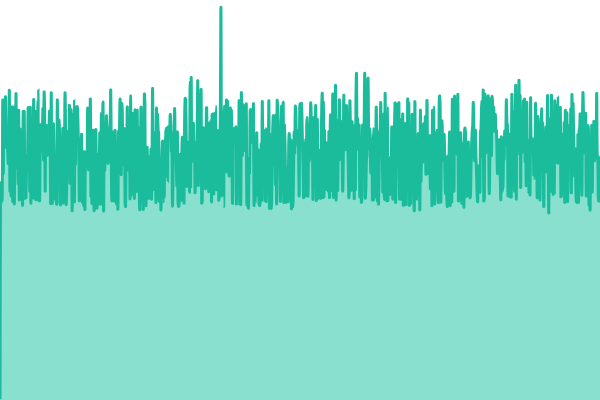
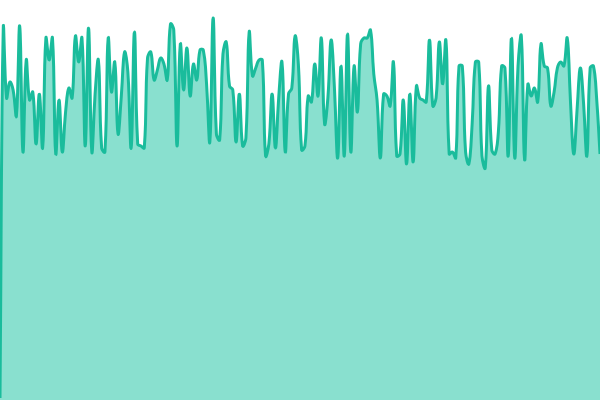

# [📈 Live Status](https://status.inkov.dev): <!--live status--> **🟩 All systems operational**

This repository contains the open-source uptime monitor and status page for [Evgeny Inkov](https://status.inkov.dev), powered by [Upptime](https://github.com/upptime/upptime).

With [Upptime](https://upptime.js.org), you can get your own unlimited and free uptime monitor and status page, powered entirely by a GitHub repository. We use [Issues](https://github.com/tzx1z/status/issues) as incident reports, [Actions](https://github.com/tzx1z/status/actions) as uptime monitors, and [Pages](https://status.inkov.dev) for the status page.

<!--start: status pages-->
<!-- This summary is generated by Upptime (https://github.com/upptime/upptime) -->
<!-- Do not edit this manually, your changes will be overwritten -->
<!-- prettier-ignore -->
| URL | Status | History | Response Time | Uptime |
| --- | ------ | ------- | ------------- | ------ |
|  [XMPP клиенты (5222)](xmpp.inkov.dev) | 🟩 Up | [xmpp-klienty-5222.yml](https://github.com/tzx1z/status/commits/HEAD/history/xmpp-klienty-5222.yml) | 

 386ms
     
 | 

<a href="https://status.inkov.dev/history/xmpp-klienty-5222">100.00%</a>
    

|  [XMPP федерация (5269)](xmpp.inkov.dev) | 🟩 Up | [xmpp-federacziya-5269.yml](https://github.com/tzx1z/status/commits/HEAD/history/xmpp-federacziya-5269.yml) | 

 311ms
     
 | 

<a href="https://status.inkov.dev/history/xmpp-federacziya-5269">100.00%</a>
    

|  [XMPP WebSocket](https://xmpp.inkov.dev/xmpp-websocket) | 🟩 Up | [xmpp-web-socket.yml](https://github.com/tzx1z/status/commits/HEAD/history/xmpp-web-socket.yml) | 

 725ms
     
 | 

<a href="https://status.inkov.dev/history/xmpp-web-socket">100.00%</a>
    

|  [XMPP клиенты TLS (443)](xmpp.inkov.dev) | 🟩 Up | [xmpp-klienty-tls-443.yml](https://github.com/tzx1z/status/commits/HEAD/history/xmpp-klienty-tls-443.yml) | 

 155ms
     
 | 

<a href="https://status.inkov.dev/history/xmpp-klienty-tls-443">100.00%</a>
    

<!--end: status pages-->

[**Visit our status website →**](https://status.inkov.dev)

## 📄 License

- Powered by: [Upptime](https://github.com/upptime/upptime)
- Code: [MIT](./LICENSE) © [Anand Chowdhary](https://anandchowdhary.com)
- Data in the `./history` directory: [Open Database License](https://opendatacommons.org/licenses/odbl/1-0/)
